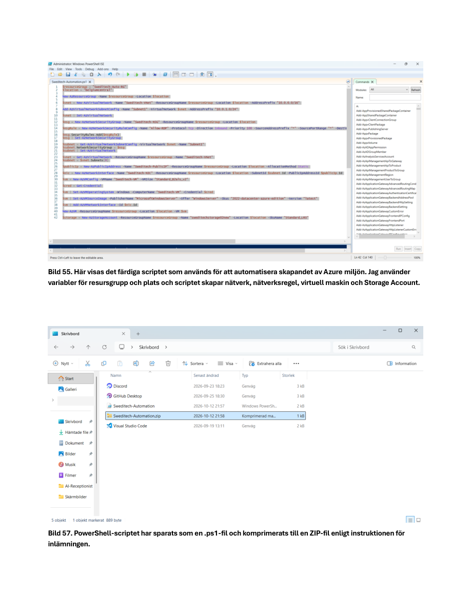

# Azure Infrastructure Automation with PowerShell

<p align="left">
  
</p>


> **Hands-on infrastructure automation:** provisioning and validating an Azure network, security rules, Windows Server VM and storage account through PowerShell.

## Project Overview

This project documents the automation part of the Sweditech AB cloud infrastructure lab. Instead of creating every resource manually in the Azure portal, I used **PowerShell and the Az module** to deploy a repeatable Azure environment.

## Provisioned Resources

| Resource | Configuration |
|---|---|
| Resource group | `Sweditech-Auto-RG` |
| Virtual network | `Sweditech-VNet` — `10.0.0.0/16` |
| Subnet | `Subnet1` — `10.0.1.0/24` |
| Network security group | `Sweditech-NSG` |
| Security rule | `Allow-RDP`, TCP 3389 |
| Virtual machine | `Sweditech-VM`, Windows Server 2022 |
| VM size | `Standard_B2als_v2` |
| Network interface | `Sweditech-NIC` |
| Public IP resource | `Sweditech-PublicIP` |
| Storage account | `sweditechstorage02new`, StorageV2, Standard_LRS |

## Automation Workflow

```text
PowerShell + Az module
        |
        v
Resource group
        |
        v
VNet + subnet
        |
        v
NSG + RDP rule
        |
        v
Public IP + NIC
        |
        v
Windows Server VM
        |
        v
Storage account
        |
        v
PowerShell validation (Succeeded)
```

## Implementation

### 1. Prepare PowerShell
- Checked the PowerShell version.
- Installed the **Az** module from PowerShell Gallery.
- Used variables for values such as resource group and region.

### 2. Provision Azure infrastructure
- Automated creation of the resource group, VNet, subnet and network security group.
- Configured an inbound RDP rule on TCP 3389.
- Created a public IP resource, NIC and Windows Server VM.
- Provisioned a Standard_LRS StorageV2 account.

### 3. Credential handling
- Used **Get-Credential** to request VM credentials interactively rather than embedding the password in the script.

### 4. Troubleshooting and validation
- Encountered an unavailable VM size (`Standard_B1s`) in the selected region.
- Changed the deployment to `Standard_B2als_v2` and completed provisioning.
- Used PowerShell to check deployed resources and confirm **Succeeded** provisioning states.


## Lab Screenshots

**PowerShell automation script**



## Script

The completed original script was saved as **`Sweditech-Automation.ps1`** and packaged in **`Sweditech-Automation.zip`** for the assignment.

**The script itself has not yet been uploaded to this repository.** Once reviewed for credentials, subscription identifiers and overly broad access rules, it can be published here.

## Security Note

The report documents an RDP rule and a public IP resource. Before reusing this script outside the lab, restrict RDP source addresses to trusted IPs and review all access rules. This lab is not presented as production-hardened infrastructure.

## What This Project Demonstrates

- Repeatable cloud provisioning using Azure PowerShell
- Resource dependency ordering across networking, compute and storage
- Variable-driven deployment configuration
- Interactive handling of VM credentials
- Troubleshooting deployment failures
- Verifying infrastructure state after deployment

---

*Educational infrastructure automation lab; not a production deployment.*